# treetabs: a guide

`treetabs` keeps all your browser windows and tabs in one tree: the ones open now and the ones you closed but want to keep. With three goals: **never lose a tab**, **stay fast with tens of thousands of tabs**, and **mirror the tree into your bookmarks** so it is never locked into one program.

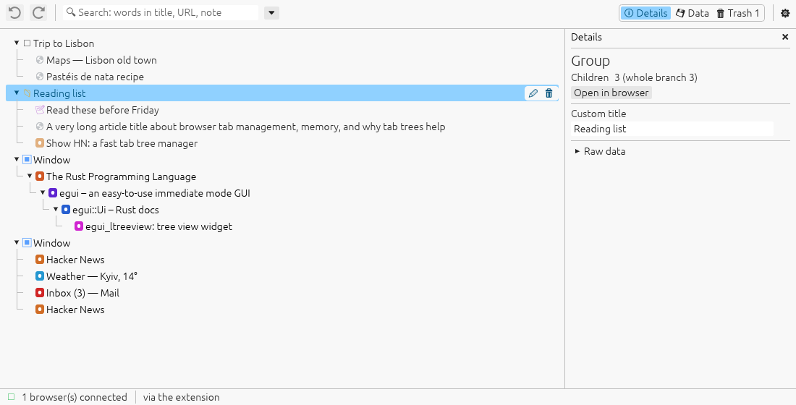

*Open windows (blue squares) with their tabs, a saved window ("Trip to Lisbon") and a group with a note. Tabs opened from a tab are nested under
it.*

---

## The tree window

Click the treetabs button in the browser toolbar, or press **Alt+T**. The tree window opens at the left edge of the screen, or where you left it last time, at the same size. Clicking the button again brings it to the front.

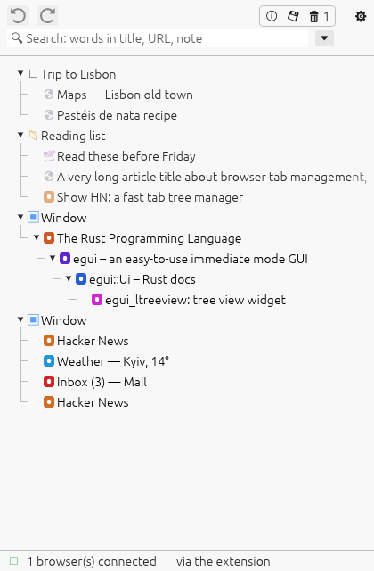

What you see:

| Row | Meaning |
|---|---|
| ▣ **Window** (blue) | an open browser window |
| □ Saved window | a window you closed; its tabs are kept |
| tab with a site icon, bold | an open tab |
| faded site icon | a saved (closed) tab |
| 📁 group | your own folder for anything |
| 📝 note | a text note |

* **Double-click** a saved tab or window to open it again; an open one is
  brought to the front.
* **Drag and drop** to reorganise. Dropping a tab into another open window
  moves it there in the browser too.
* **Closing a tab** in the browser moves it to the trash (its children move
  up). **Closing a window** keeps it as a saved window.
* After a browser restart the windows are matched by their tabs, so you
  don't get duplicates.

The top bar has the frequent actions on the left (undo, redo, search) and the views on the right: the panel tabs **Details | Data | Trash** and **⚙ Settings**. In the narrow window they show as icons.

## Working with rows

Point at a row to get its buttons at the right edge of the tree: rename, close (keeps it saved) and delete.

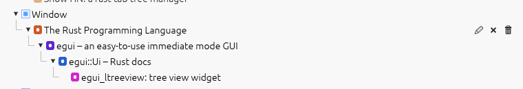

Right-click a row for everything else:

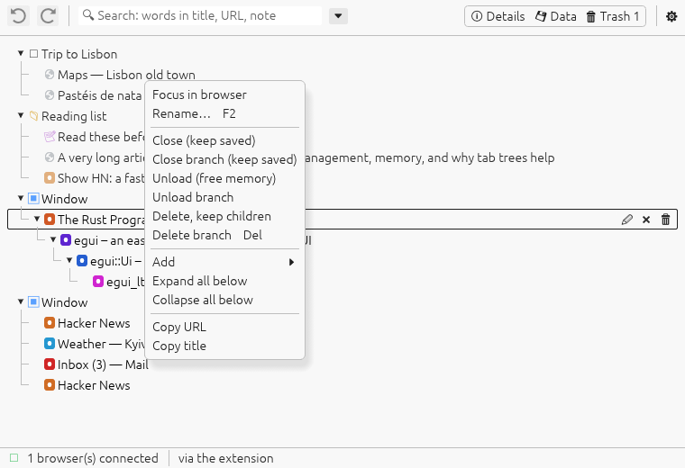

* **Close** / **Close branch**: closes the tabs in the browser, keeps them
  in the tree as saved.
* **Unload**: frees the tab's memory; it stays open and loads again when
  you go to it.
* **Delete, keep children** / **Delete branch**: moves to the trash.
* **Add** a note or group after or inside the row.
* **Expand / Collapse all below**, **Copy URL**, **Copy title**.

Keys: **F2** rename, **Delete** delete the branch, **Shift+Delete** delete the row only, **Ctrl+Z / Ctrl+Y** undo and redo. Deleting a big branch asks first (Settings > Deleting).

## Search

Type words in the search box: every word must appear in the title, the URL, the note or your own name for the row. Matches are highlighted, and each result shows where it is in the tree.

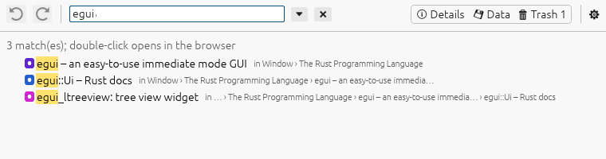

The ⏷ menu next to the box filters: **open** only, **saved** only, or **duplicates**: tabs open more than once (the same page, ignoring `#…` and a trailing `/`).

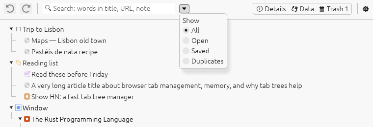

With duplicates shown, **Close N duplicate(s)** keeps one copy of each page (an open one if there is) and moves the others to the trash.

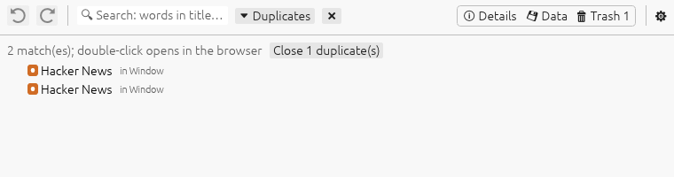

**Esc** clears the search and the filters. If you use more than one browser profile with the same tree, the filter menu can also show one profile only, and each window is labelled with its browser.

## Trash

Nothing is deleted right away: it goes to the trash, newest first. **Restore** puts a row back where it was. **Empty trash…** asks first, and **Remove items older than** cleans up automatically (never, 7, 30, 90 or 365 days). Before anything is removed for good, today's backup is saved with it.

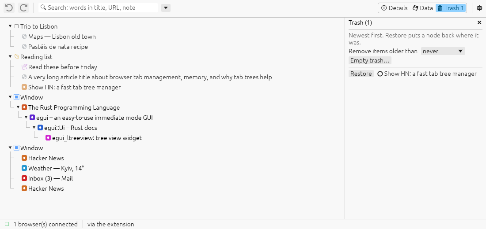

## Data: import, export and backups

The **Data** tab (💾) holds everything that goes in and out of the tree.

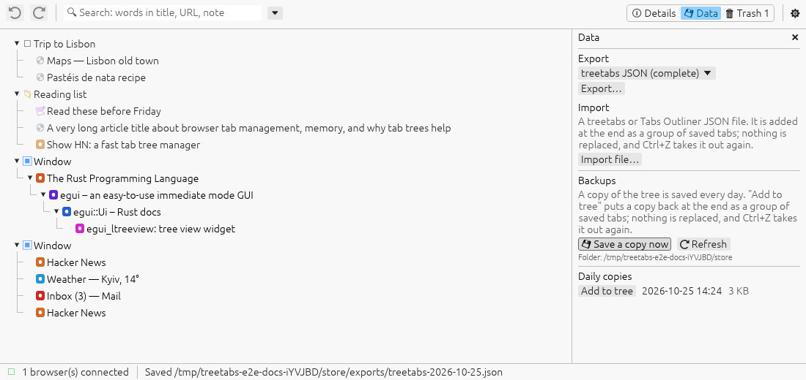

**Export** saves the whole tree as a file (a download in the browser, a save dialog in the desktop app), in one of four formats:

| Format | For |
|---|---|
| treetabs JSON (complete) | everything; can be imported back, by treetabs or by `treetabs import` |
| Tabs Outliner JSON | importing into Tabs Outliner |
| Bookmarks HTML | importing into any browser's bookmarks (windows and groups become folders) |
| Markdown list | reading, notes, sharing: a nested list of links |

**Import file…** takes a treetabs or Tabs Outliner JSON file. It is added at the end as a group of saved tabs: nothing is replaced, and Ctrl+Z takes it out again.

**Backups:** once a day the whole tree is saved as a plain JSON file (the last 30 are kept). The list shows them, together with the snapshots the store makes on its own. **Add to tree** puts a copy back at the end as a group of saved tabs; **Save a copy now** makes one immediately.

Under the hood every change is written to a journal on disk before it counts, so even a crash loses nothing.

## Bookmarks

The tree is mirrored into a bookmark folder, `Other bookmarks/treetabs`: windows and groups become folders, tabs become bookmarks. It works both ways: renaming, moving or deleting bookmarks there changes the tree. Your tree is therefore also in the browser's own bookmarks, and in its sync.

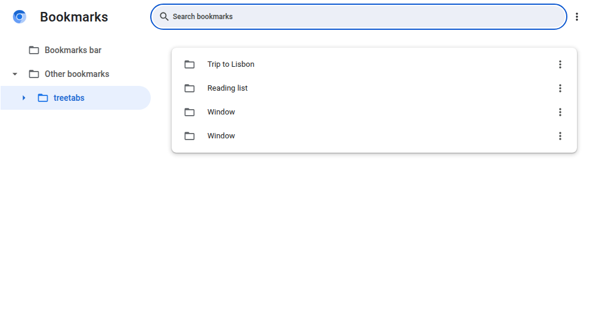

Turn it off with `{"bookmarks": false}` in `<store>/settings.json`

## Settings

⚙ opens the settings, in three tabs. Changes apply right away and are remembered.

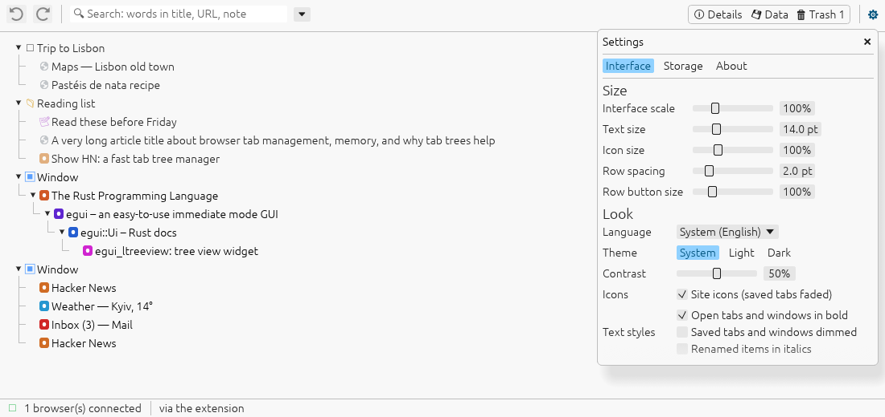

**Interface**

* **Size**: interface scale (applied when you let go of the slider, so nothing moves under the pointer), text size, icon size, row spacing, row button size. The mouse wheel moves the sliders.
* **Look**: language, theme (system, light, dark), contrast, site icons, text styles (open tabs bold, saved ones dimmed, renamed ones italic), row  buttons on hover.
* **Deleting**: how big a branch can be before deleting it asks first.

**Storage** shows the folder where the tree is kept, and can move it:

type another folder and press **Move…**. Everything is copied there, the companion program restarts and uses the new folder from then on; the old folder stays until you delete it. (A snap browser can only reach folders inside its own snap folder, such as `~/snap/chromium/common/`.)

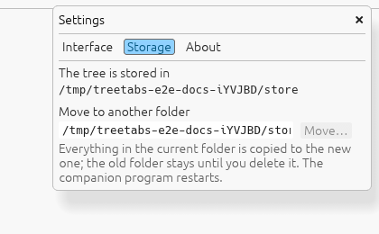

Without the companion app, Storage says *In this browser's own storage*.
The **Companion app** button below turns the app on or off; see
[USER-GUIDE.md](USER-GUIDE.md).

**About**: what treetabs is, its version, and where the tree is.

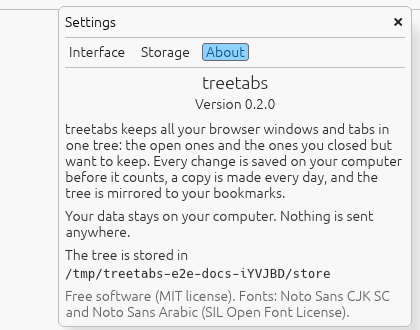

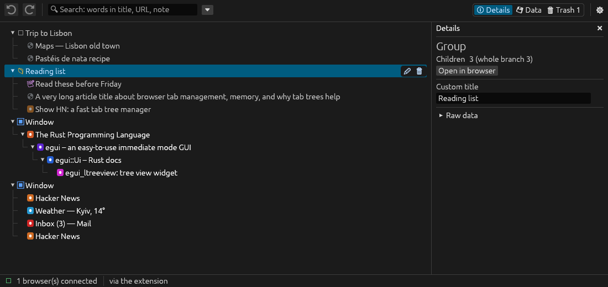

## Languages

English, French, Ukrainian, Spanish, Portuguese, Finnish, German, Chinese,Russian, and Arabic (Modern Standard Arabic with Egyptian, Levantine, Maghrebi, Gulf and Iraqi variants). By default the browser's language is used.

| Ukrainian | Chinese |
|---|---|
| 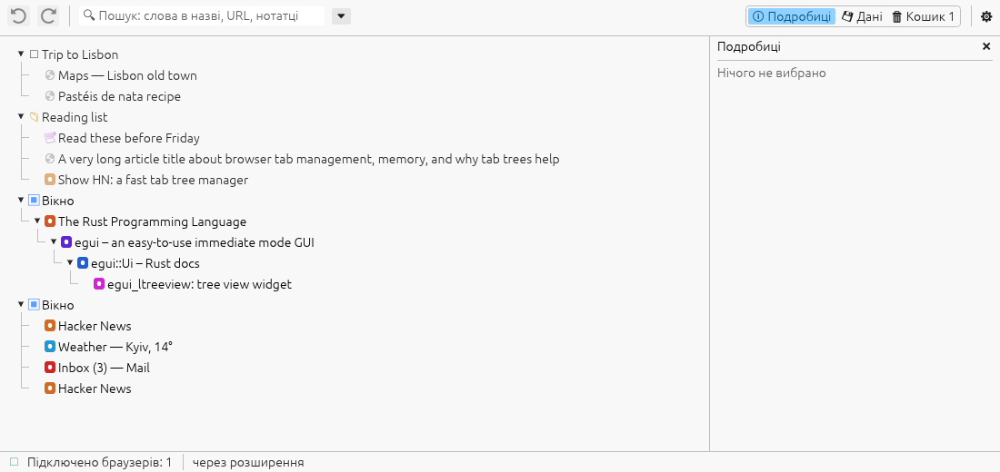 | 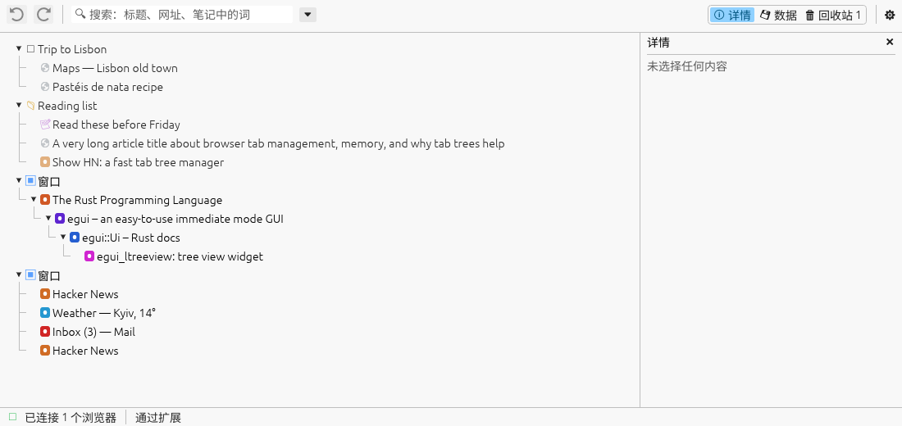 |

In Arabic the interface is mirrored: the bars run right to left and the panel is on the left. Arabic text, also in tab titles and in the search box, is shown in the correct right-to-left order.

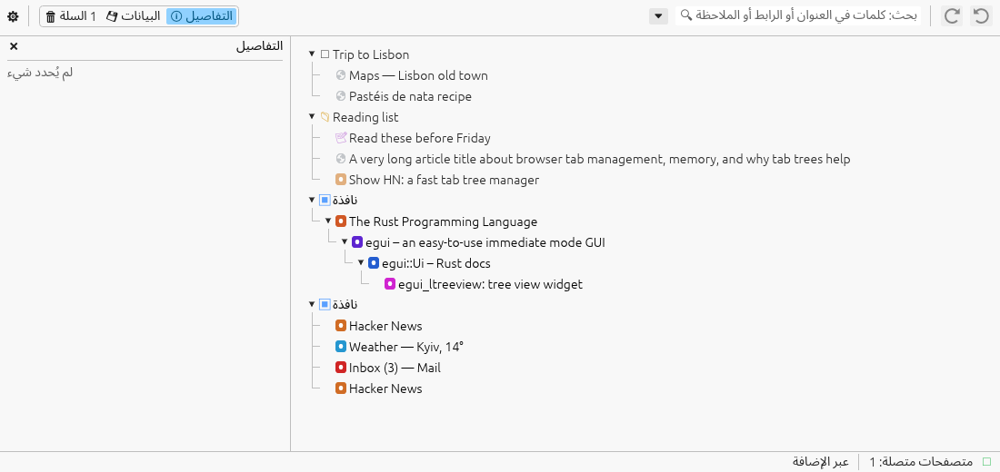

## Browsers

Chromium, Google Chrome, Brave, Opera and Firefox, including the Ubuntu snap versions. Several browsers can share one tree, each window labelled with its browser. See [INSTALL.md](INSTALL.md).

## Moving from Tabs Outliner

```sh
treetabs import tabs-outliner-export.json      # or the Tabs Outliner IndexedDB folder
treetabs history <idb-folder> --recover lost.json   # tabs only older Tabs Outliner versions still had
```

The import keeps everything Tabs Outliner stored (titles, notes, saved windows, collapsed state), and writes it back in Tabs Outliner's format

```sh
treetabs convert tree.json -f tabs-outliner -o export.json
``` 


## Large trees

The tree has been tested with 48,000 nodes: scrolling stays smooth (only the rows on screen are drawn in full), and the tree window opens in about 2.5 seconds even while the bookmark mirror is still catching up.
